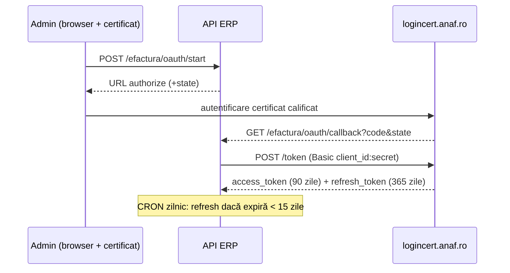
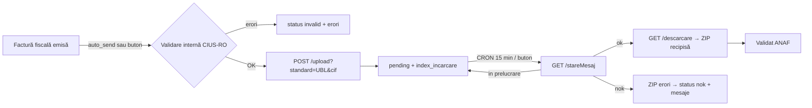
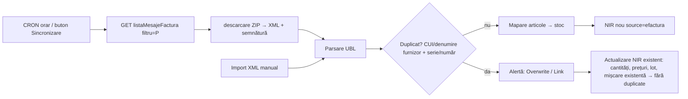

# Integrare RO e-Factura — documentație tehnică

## 1. Structură bază de date (MongoDB)
| Colecție | Câmpuri cheie | Rol |
|---|---|---|
| `efactura_config` (_id=`main`) | environment (`simulare`/`test`/`prod`), client_id, client_secret (Fernet), redirect_uri, auto_send, access_token / refresh_token (Fernet), token_expires_at, refresh_expires_at, connected_at, last_refresh_at, oauth_state, last_error | Setări API + token-uri OAuth criptate |
| `efactura_logs` | op (oauth/refresh/upload/status/inbox/config/cron-*), ok, message, invoice_id, env, at | Jurnal audit integrare |
| `invoices.efactura` (subdocument) | status (`not_sent`/`generated`/`invalid`/`pending`/`ok`/`nok`/`error`), upload_index, download_id, errors[], env, xml, sent_at, checked_at, history[] | Stare factură emisă |
| `efactura_files` | invoice_id, name, content (ZIP base64, recipisă + semnătură MF), at | Arhivă recipise |
| `efactura_inbox` | message_id (unic), id_solicitare, cif_emitent, data_creare, source (`spv`/`import`), xml, signature_xml, parsed{supplier_cui, supplier_name, series_number, issue_date, lines[], net, vat, gross}, status (`parsed`/`nir_created`/`linked`), nir_id, nir_number, changes[] | Facturi primite de la furnizori |
| `product_mappings` | supplier_cif, key (cod/denumire articol furnizor), product_id | Memorare mapare articol furnizor → stoc propriu |
| `nirs` (câmpuri noi) | source (`efactura`), efactura_message_id, efactura_linked, supplier_cui, updated_from_efactura_at, unmatched_lines[] | Legătura NIR ↔ XML |
| `cron_runs` | _id=X-Webhook-Id, job, at | Idempotență job-uri CRON |

## 2. Fluxuri

## 3. Servicii cod
- `backend/anaf_service.py` — criptare, config, OAuth (authorize/exchange/refresh), `anaf_request` (refresh automat la 401), `validate_ubl`, `anaf_public_validate`, `send_invoice`, `check_status`, `download_zip`, `poll_pending`, `refresh_if_needed`.
- `backend/efactura_inbox.py` — `parse_ubl`, `sync_inbox`, `find_supplier`, `find_duplicate_nir`, `suggest_products`, `create_nir_from_message`, `link_overwrite`.
- `backend/routes_efactura.py` — endpoint-uri REST + `/api/cron/efactura/{tokens|status|inbox}` (Bearer WEBHOOK_CRON_SECRET).
- `backend/efactura.py` — generator UBL 2.1 CIUS-RO.
- Frontend: `pages/EfacturaSettings.js`, `components/EfacturaPanel.js`, `components/EfacturaInbox.js`.
- CRON: `.emergent/crons.yml`.

## 4. Pași punere în producție
1. Completați datele reale în Setări companie (CIF, adresă, cod județ ISO).
2. Portal ANAF → Gestionare aplicații OAuth → serviciul e-Factura → callback = Redirect URI afișat în aplicație.
3. Administrare › eFactura: Client ID/Secret → mediu Test → Conectare SPV (certificat calificat) → test trimitere → comutare Producție.
